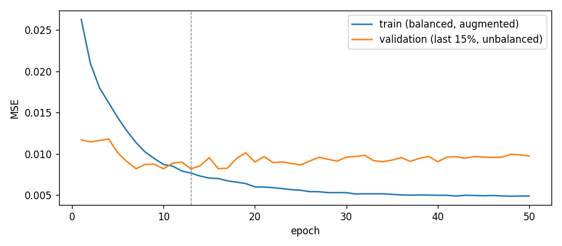

# BeamNG Autopilot

Camera-based lane keeping and adaptive cruise control for a car in the
[BeamNG.tech](https://beamng.tech/) simulator. Python, OpenCV, PyTorch and
YOLO26.

The car drives from one front camera (800×600, 70° FOV) and a depth image
from the same position. Steering comes from two sources that are blended at
runtime:

- a lane detector (colour threshold, Canny, Hough lines) feeding a PID controller
- a DAVE-2 CNN trained by behavioral cloning on my own driving

The blend weight follows the lane detector's confidence. With clear markings
the PID gets up to 85% of the steering; when the markings fade the network
takes over. Speed is handled by an ACC loop: YOLO26n finds the car ahead, the
depth image gives the distance, and a PD controller holds a 12 m gap. The
target speed also drops in curves.

```
                  ┌─> lane detection ──> PID ──┐
camera (RGB) ─────┤                            ├─> blend by lane confidence ─> steering
                  └─> DAVE-2 CNN ──────────────┘

camera (RGB) ───> YOLO26n ─┐
camera (depth) ────────────┴─> distance to lead car ─> PD + curve slowdown ─> throttle / brake
```

## Results

### Steering network (offline)

Dataset: 17,904 frames (≈6 min of driving at 48 fps, two sessions on
west_coast_usa). The last 15% of the recording (2,686 frames) is held out as
validation. The split is by time, not random: at 48 fps neighbouring frames are
almost identical, and a random split leaks them into validation.

Steering is the wheel angle normalized to [-1, 1]. The baseline is a model that
always outputs 0, which is a strong baseline here because 73% of the frames are
straight driving.

| Metric (validation) | DAVE-2 | Always 0 |
|---|---|---|
| RMSE, all frames | **0.091** | 0.110 |
| MAE, all frames | 0.057 | 0.056 |
| MAE, curve frames (\|steer\| ≥ 0.1, n = 581) | **0.141** | 0.203 |
| MAE, straight frames | 0.034 | – |
| Correct steering direction in curves | 90.2% | – |
| R² | 0.33 | 0 |

On straight road the network adds small errors that the always-0 model
doesn't make, so overall MAE is a tie; the gain is in curves, where it
matters for steering. The network has 252k parameters. Validation loss is lowest at epoch 13 and
the model overfits after that, which is expected with only 6 minutes of data;
the weights from epoch 13 are kept.



### Processing time per frame

Measured with `benchmark.py` on an RTX 5060 Laptop GPU and a Ryzen 7 260
(300 runs, 800×600 input).

| Stage | Device | Median | p95 |
|---|---|---|---|
| Lane detection | CPU | 3.7 ms | 6.2 ms |
| DAVE-2 incl. preprocessing | CPU | 1.4 ms | 3.0 ms |
| YOLO26n (end-to-end ultralytics call) | GPU | 30.3 ms | 42.1 ms |
| YOLO26n | CPU | 35.8 ms | 45.9 ms |

Perception takes about 35 ms per frame. In the simulator the full control loop
runs at 7–9 Hz, so most of the time goes to things outside perception (camera
readback from BeamNG, sensor polling, display).

### Closed-loop test on Utah

Utah is a map the network has never seen. Best run so far, from
`log_summary.py` (AI traffic on, cruise speed 45 km/h):

| | |
|---|---|
| Distance before leaving the road | 307 m in 73 s |
| Mean / max speed | 15.1 / 44.8 km/h |
| Lane markings found (while moving) | 71% of control steps |
| Lane PID share of steering | 57% |
| Lead car tracked | 29% of steps, closest gap 5.4 m |

On straight Utah road the network outputs ±0.6–0.8 steering, so it does not
transfer from west_coast_usa. Where the lane detector loses the markings the
car follows the network and drifts off. This run used the previous model
trained with a random split; the closed-loop numbers for the current model
are not measured yet.

## How it works

**Lane detection** (`lane_detection.py`). White and yellow paint is picked
out in HLS space, edges are found with Canny inside a trapezoid ROI, and
Hough segments are split into left and right lines by slope. Each line is
fitted as x = m·y + b and smoothed with a median over the last 10 frames.
The lane centre is measured on a lookahead row at 65% of the image height.
Pairs that cross inside the ROI, or whose width differs by more than 30% from
the running lane width, are rejected. Confidence rises by 0.15 per frame with
both lines found, by 0.04 with one line (capped at 0.65), and falls by 0.10
otherwise. Below 0.25 the lane output is ignored.

**Behavioral cloning** (`bc_collect.py`, `bc_train.py`, `dave2.py`). Frames
are cropped to the road area, resized to 200×66 and converted to YUV, as in
the NVIDIA paper. Straight frames are undersampled to at most twice the number
of curve frames (15,218 → 12,786 training frames). Augmentation: horizontal
flip with negated steering, brightness ×0.6–1.4, and Gaussian label noise
(σ = 0.005). Adam, lr 1e-4, batch 64, MSE loss.

**ACC** (`vehicle_detection.py`, `acc.py`). Only cars, buses, trucks and
motorcycles with their centre in the middle 60% of the frame count as the lead
vehicle. Distance is the 20th percentile of the depth values inside the box,
which ignores a few noisy pixels without being pulled toward the background.
In `autopilot.py` the controller uses the gap error (kp 0.10) and closing speed (kd 0.30), and
brakes fully below 5 m.

**Smoothing**. Per 50 ms control tick, steering can change by at most 0.03,
throttle by 0.04 and brake by 0.10. Without this the car twitches from
frame-to-frame noise in the vision output.

## Scripts

| File | What it does |
|------|--------------|
| `autopilot.py` | Full system: blended steering + ACC + curve slowdown |
| `lane_keeping.py` | Lane detector + PID only, logs every step to CSV for tuning |
| `acc.py` | ACC only, you steer |
| `bc_collect.py` | Record frames and steering while you drive |
| `bc_train.py` | Train DAVE-2, write `models/bc_metrics.json` and the loss plot |
| `bc_drive.py` | Drive with the network only |
| `benchmark.py` | Per-frame time of each perception stage, no simulator needed |
| `log_summary.py` | Distance, speed and lane/ACC statistics from autopilot logs |
| `camera_test.py` | Check that BeamNG and the camera work |
| `m5stick_dashboard/` | Speed / RPM / gear display on an M5StickC Plus over WiFi |

## Setup

You need BeamNG.tech, not BeamNG.drive from Steam. The camera and depth
sensors only work with a BeamNG.tech licence (academic licences are free).
Tested with BeamNG.tech v0.38.3, beamngpy 1.35, Python 3.12.

```bash
pip install -r requirements.txt
```

Point `BNG_HOME` at your BeamNG.tech folder. If the default API port (64256)
is taken, set `BNG_PORT`.

```bash
# Windows
set BNG_HOME=C:\path\to\BeamNG.tech.v0.38.3.0
```

The trained model is in `models/bc_model.pth`. YOLO26n is downloaded
automatically on first run.

## Running

```bash
python autopilot.py                     # use the car you are driving in freeroam
python autopilot.py --map utah --traffic 8 --engage --log --record --duration 60
python log_summary.py data/autopilot_log_*.csv
```

| Flag | |
|---|---|
| `--map utah\|west_coast_usa` | load the map and spawn the car |
| `--traffic N` | spawn N AI cars (with `--map`) |
| `--engage` | start with the autopilot on |
| `--log` / `--record` | write a CSV log / HUD video to `data/` |
| `--duration S` | quit after S seconds |

Keys (click the camera window first):

| Key | |
|-----|---|
| `A` | autopilot on / off |
| `+` / `-` | cruise speed ±5 km/h |
| `D` | debug view (lane mask and ROI edges) |
| `Q` | quit |

To train your own model:

```bash
python bc_collect.py   # drive, press R to record
python bc_train.py     # or: python bc_train.py --data path/to/recording
```

## M5Stick dashboard

`beamng_telemetry.py` listens for BeamNG's OutGauge UDP packets and forwards
RPM, speed, gear, throttle and brake to the M5StickC Plus. The Arduino
sketch draws them on the screen. Set your WiFi details in the `.ino` file
and the device IP in the Python script.

## Limitations

- The network was trained on 6 minutes of driving on one map. It beats the
  always-straight baseline on held-out data but does not generalize to Utah.
- Lane detection is tuned for painted lines. It struggles on dirt roads, in
  strong shadows and at junctions.
- ACC treats any vehicle in the middle of the frame as the lead vehicle;
  detected cars are not assigned to lanes.
- The control loop runs at 7–9 Hz in the simulator.
- No lane changes, traffic lights or route planning.

## Next steps

- Collect data on Utah automatically with the BeamNG AI driver, plus recovery
  data from lateral offsets, and retrain.
- Measure closed-loop distance between interventions on both maps.

## License

MIT
